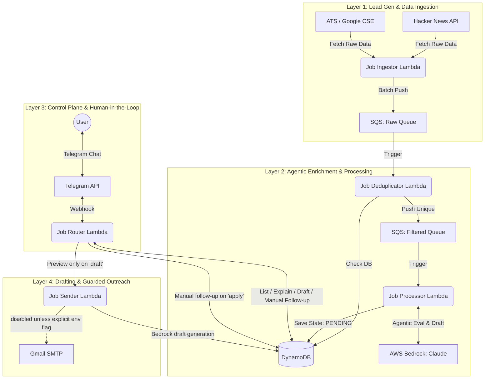

# Agentic Job Pipeline: System Architecture

*Prepared for: Jeeva.AI Interview Discussion*

This document breaks down the multi-agent architecture of the JobHunt pipeline, mapping it directly to standard enterprise AI automation layers (similar to how Jeeva.AI structures outbound sales automation).

## High-Level Architecture Diagram

---

## 1. The Lead Generation & Ingestion Layer
*Equivalent to Jeeva pulling leads from LinkedIn or Apollo.*
* **Component:** `job-ingestor` (AWS Lambda)
* **Function:** Acts as the data scraper. It targets unstructured startup threads (Hacker News) and Applicant Tracking Systems (ATS) to pull high-intent leads.
* **Resilience:** It uses regex to extract recruiter emails and cleans messy HTML. It batches jobs in blocks of 10 and pushes them to AWS SQS (`job-raw-queue`) to prevent downstream throttling.

## 2. The Enrichment & Agentic Processing Layer
*Equivalent to Jeeva using LLMs to research a prospect and draft a personalized email.*
* **Components:** `job-deduplicator`, `job-processor` (AWS Lambdas), AWS Bedrock
* **Function:** 
  1. The deduplicator drops any jobs that already exist in DynamoDB, ensuring zero duplicate work.
  2. The processor acts as the core LLM Agent. It retrieves the job, feeds the description and the user's resume into Anthropic's Claude, and executes a deterministic evaluation.
  3. Claude returns a structured JSON payload containing: `score` (0-100), `reasoning`, and a highly `personalized_email_draft`.
* **State Management:** The processed lead is saved to DynamoDB with a state of `PENDING_APPROVAL`.

## 3. The Control Plane (Human-in-the-Loop) Layer
*Equivalent to Jeeva's user dashboard where sales reps review and approve AI-generated campaigns.*
* **Component:** `job-router` (AWS Lambda), Telegram Bot API
* **Function:** The user interface. Instead of building a complex React frontend, the system relies on a Telegram Webhook.
* **Interaction:** The user texts `status` to audit counts, roles, source names, source links, contacts, and model reasons. They use `list` for high-confidence matches, `explain 1` for scoring rationale, and `draft 1` for a preview-only outreach draft. `apply 1` only moves the item to manual follow-up and never sends email from Telegram.
* **Anti-hallucination rule:** Every visible opportunity must carry a source link. If a row has no source link, the bot tells the user not to act on it.

## 4. The Drafting & Guarded Outreach Layer
*Equivalent to Jeeva generating a human-reviewed outbound step, with dispatch behind a safety gate.*
* **Component:** `job-sender` (AWS Lambda), Gmail API
* **Function:** When the user issues `draft 1`, the sender generates a preview-only draft. It does not fetch SMTP credentials or send email in preview mode.
* **Execution safety:** Real SMTP delivery is disabled by default through `ALLOW_REAL_EMAIL_SEND=false`. This keeps the interview demo honest: the AI can research, score, cite, and draft, but a human decides whether to actually contact anyone.
