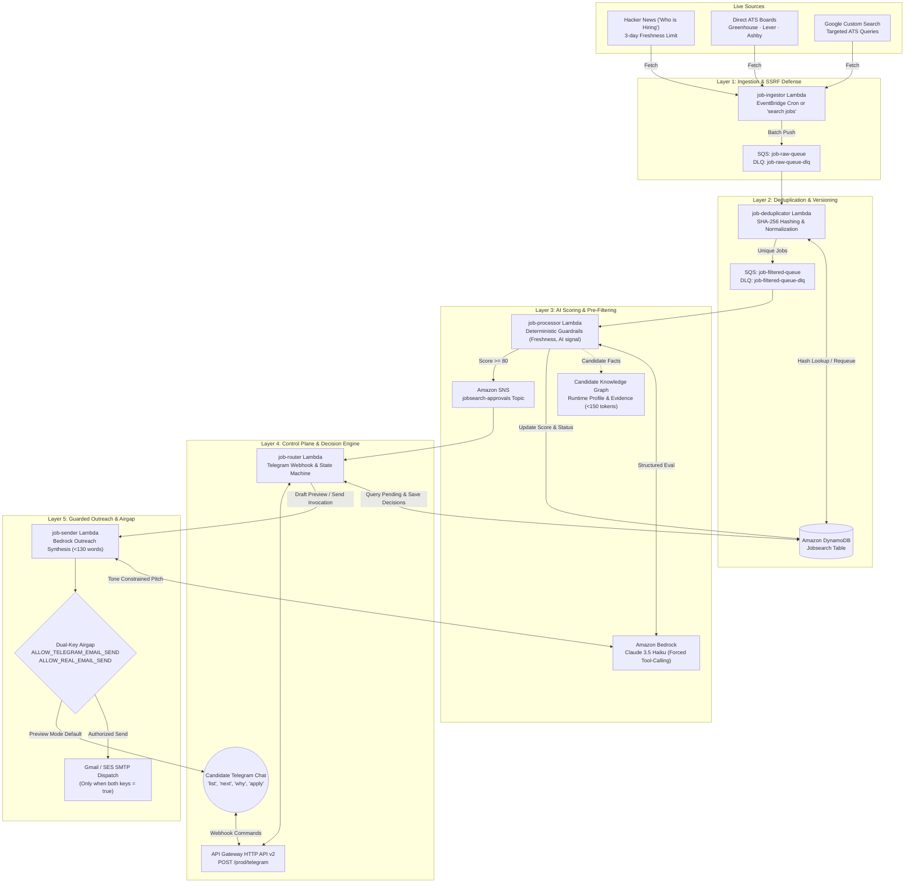

# JobHunt — Autonomous AI Job Pipeline

> Telegram-controlled multi-agent system that discovers, deduplicates, scores, and drafts outreach for AI engineering opportunities — all from your phone.

[](https://github.com/Nites-24/jobhunt/actions/workflows/ci.yml)
[](https://github.com/Nites-24/jobhunt/actions/workflows/health-monitor.yml)

---

## What This Is

A production autonomous job pipeline running on AWS. It finds fresh, real AI engineering opportunities, scores them against a candidate profile, explains the evidence, drafts concise outreach, and keeps a human approval gate before any email is sent.

The product promise is not "more jobs." The promise is **fewer, fresher, better-grounded opportunities with source evidence**.

## Architecture



See [Architecture Doc](docs/Architecture_Doc.md) for the full system design with Mermaid diagrams.

## Key Features

| Feature | How It Works |
|---------|-------------|
| **Multi-source ingestion** | Hacker News, Direct ATS boards (Greenhouse, Lever, Ashby), Google CSE, JSearch |
| **Smart deduplication** | SHA-256 hash on (title, company, URL) + evaluation versioning |
| **Deterministic guardrails** | Pre-LLM rejection for stale, missing-date, low-signal, no-URL jobs |
| **LLM scoring** | Bedrock Claude with forced tool-calling for structured JSON output |
| **Human-in-the-loop** | Telegram review: `next → why → draft → skip/apply` |
| **Guarded outreach** | Email requires 2 explicit env flags before real SMTP send |
| **Feedback learning** | `interested`, `meh`, `not interested` → DynamoDB → eval exports |
| **Source grounding** | Every opportunity must have a verifiable source link |
| **Knowledge graph** | Compact candidate profile to reduce Bedrock token costs |

## Project Structure

```
jobhunt/
├── .agents/workflows/        # Agent executive charters & workflows
│   ├── founding-ai-engineer.md
│   ├── orchestrator.md
│   ├── tester.md
│   ├── security-auditor.md
│   └── open-source-expert.md
│
├── .github/workflows/        # CI/CD, monitoring, analytics
│   ├── ci.yml                # Tests + scoring evals + lint + security audit
│   ├── deploy.yml            # Selective Lambda deployment
│   ├── health-monitor.yml    # 6-hourly production health checks
│   ├── pipeline-analytics.yml # Daily 90-day metrics report
│   ├── feedback-export.yml   # Weekly feedback data export
│   └── source-quality-audit.yml # Daily source health matrix
│
├── job_ingestor/             # Lambda: fetch jobs from sources
├── job_deduplicator/         # Lambda: normalize duplicates
├── job_processor/            # Lambda: score with Bedrock + guardrails
├── job_router/               # Lambda: Telegram control plane
├── job_sender/               # Lambda: email preview/send
│
├── shared/                   # Shared runtime (knowledge_graph.py, url_validation.py)
├── agents/                   # Local diagnostic agents (QA, SecurityAuditor, PythonDev, Orchestrator)
├── tests/                    # Unit tests (moto mocks)
│   └── live/                 # Opt-in AWS smoke tests
├── tools/ops/                # Deployment, diagnostics, ops scripts
├── evals/                    # Labeled scoring eval data
├── docs/                     # Architecture, implementation logs
│
├── AGENTS.md                 # Agent operating contract
├── CONTRIBUTING.md           # Development guidelines
├── SECURITY.md               # Security policy
├── CHANGELOG.md              # Version history
├── LICENSE                   # MIT License
├── deploy.py                 # Lambda deployment script
└── pyproject.toml            # pytest configuration
```

## Quick Start

### Prerequisites

- Python 3.11+
- AWS account with Lambda, DynamoDB, SQS, SNS, S3, Bedrock
- Telegram bot token
- Source API credentials (Google CSE, Hunter.io, JSearch)

### Local Development

```bash
# Install test dependencies
pip install pytest moto[all] boto3

# Run unit tests (offline moto mocks, no AWS needed)
pytest -q

# Run scoring guardrail evals
python tools/ops/eval_scoring.py

# Run zero-trust security & identity audit
python tools/ops/run_agents.py --security

# Run QA agent check
python tools/ops/run_agents.py --qa
```

### Deployment

```bash
# Deploy all Lambdas
python deploy.py

# Deploy selectively via GitHub Actions
# Push to main, or use workflow_dispatch
```

### Production Verification

```bash
# Read-only health check
python tools/ops/verify_live_production.py

# Full check (touches AWS)
python tools/ops/run_agents.py --full
```

## Telegram Commands

| Command | Action |
|---------|--------|
| `search jobs` | Trigger live ingestion across all sources |
| `list` | Show fresh reviewable matches |
| `next` | Review next match in guided flow |
| `why` | Explain scoring rationale |
| `draft` | Preview outreach email |
| `apply` | Move to manual follow-up |
| `skip <reason>` | Skip with feedback |
| `status` | Pipeline health + counts |
| `backlog` | Show hidden pending jobs |
| `interested` / `meh` / `not interested` | Feedback capture |

## Production Operations & Stale Job Management

### How Stale Jobs are Eliminated
1. **Source Freshness Policies**:
   - **Hacker News**: Postings older than 3 days are rejected at ingestion (`HN_MAX_JOB_AGE_DAYS=3`).
   - **Direct ATS Boards**: Live active postings from Greenhouse, Lever, and Ashby boards are ingested directly without scraping delays.
2. **Review Queue Freshness Policy**:
   - `job-router` enforces a strict 1-day freshness cutoff (`MAX_JOB_AGE_DAYS=1`). Older opportunities are automatically excluded from `list` and `next` review views.
3. **Deterministic Scoring Caps**:
   - In `job-processor`, stale jobs (>14 days, HN >3 days) are capped at 55% score (`STALE_SCORE_CAP=55`), automatically marking them `REJECTED` and preventing Bedrock token spend.

### How to Reconcile & Clear Existing Stale Jobs in Production
To purge or sweep stale items already stored in the DynamoDB `Jobsearch` table:

```bash
# 1. Audit pending review queue freshness (read-only):
python tools/ops/check_freshness.py

# 2. Reconcile review queue against 1-day freshness & 80%+ match policy:
python tools/ops/reconcile_review_queue.py         # Dry-run audit
python tools/ops/reconcile_review_queue.py --apply # Transitions stale jobs to REJECTED

# 3. Purge sub-80% matches from pending review:
python tools/ops/cleanup.py

# 4. Verify clean queue state:
python tools/ops/check_status.py
```

## CI/CD & Monitoring

| Workflow | Schedule | Purpose |
|----------|----------|---------|
| **CI** | Every push/PR | Tests, evals, lint |
| **Deploy** | Manual + main push | Selective Lambda deploy with approval gate |
| **Health Monitor** | Every 6 hours | Lambda, SQS, DLQ, CloudWatch checks |
| **Pipeline Analytics** | Daily | 90-day metrics: ingestion, scoring, feedback |
| **Feedback Export** | Weekly | Telegram feedback → eval-ready JSON |
| **Source Quality Audit** | Daily | Per-source health matrix |

## Safety Controls

- **Email gating**: Real SMTP requires `ALLOW_TELEGRAM_EMAIL_SEND=true` on router AND `ALLOW_REAL_EMAIL_SEND=true` on sender
- **Pre-LLM filtering**: Stale, missing-date, low-signal, no-URL jobs rejected before Bedrock
- **Deploy approval**: GitHub Actions requires manual approval for production
- **DLQ monitoring**: Dead letter queues on all SQS queues
- **Candidate truth**: Knowledge graph enforces factual claims only

## Documentation

- [Architecture Doc](docs/Architecture_Doc.md) — Full system design with diagrams
- [Implementation Log: May 13](docs/implementation_2026_05_13.md) — Production debug session
- [Implementation Log: May 14](docs/implementation_2026_05_14.md) — UX and feedback improvements
- [Sprint Report](docs/sprint_report_2026_05_12.md) — Initial architecture decisions
- [Agent Contract](AGENTS.md) — Operating rules for AI agents

## License

MIT — see [LICENSE](LICENSE).
