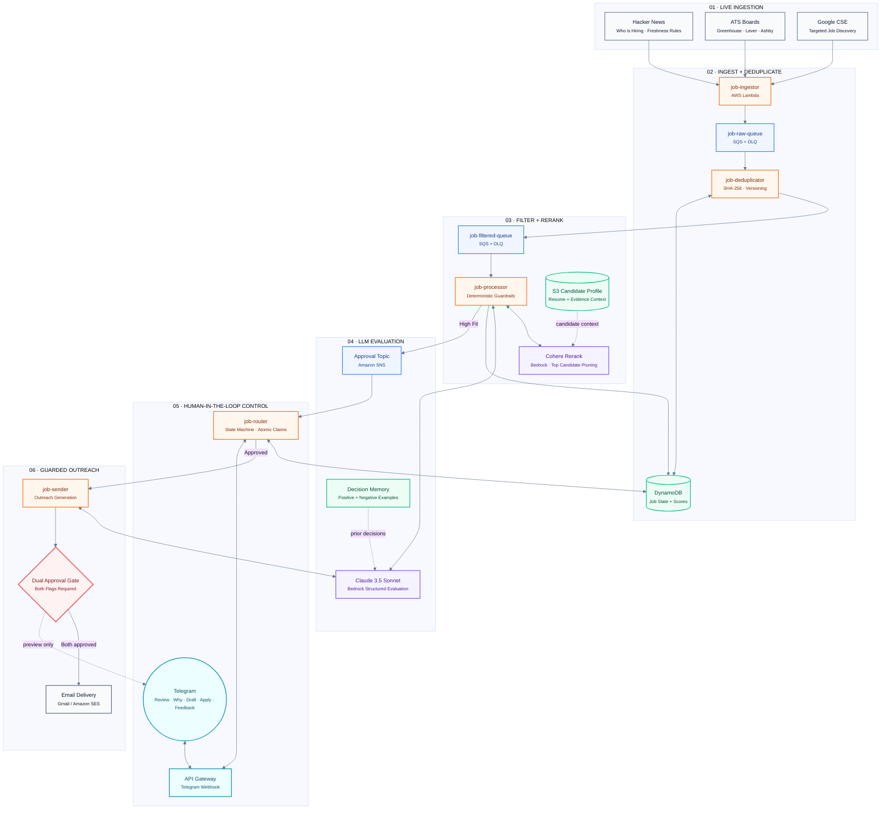

# JobHunt — Enterprise Autonomous Job Intelligence & Outreach Harness

> **A production-grade, serverless multi-agent pipeline on AWS that discovers, deduplicates, reranks, scores, and drafts high-conviction outreach for engineering opportunities — controlled via Telegram with dual-key human-in-the-loop airgapping.**

<p align="center">
  <a href="https://github.com/Nites-24/jobhunt/actions/workflows/ci.yml"></a>
  <a href="https://github.com/Nites-24/jobhunt/actions/workflows/health-monitor.yml"></a>
  
  
  
  
  <a href="LICENSE"></a>
</p>

---

## 🏛️ Executive Summary

Modern job search tools are broken: scrapers dump thousands of unverified listings, generic bots blast boilerplate cover letters, and candidates spend hours tailoring resumes for closed or ghost postings.

**JobHunt** inverts this paradigm. Rather than maximizing volume, it enforces an uncompromising quality filter:
* **Fewer jobs**: 90%+ of noisy, stale, or generic postings are dropped deterministically before any LLM is invoked.
* **Mathematically grounded**: Leads are cross-encoded using native **Amazon Bedrock Cohere Rerank** against verified candidate memory.
* **Zero hallucinations**: Scored with **Claude 3.5 Sonnet** via forced tool-calling with traceable citations.
* **Dual-key human-in-the-loop**: Outreach requires two explicit authorization gates; the agent *never* emails autonomously.
* **100% Zero-Trust & Identity-Agnostic**: Zero candidate PII or credentials in git; fully parameterized 12-factor runtime injection.

---

## 📐 Production AI Job Intelligence Platform — Event-Driven AWS + Bedrock + HITL Architecture



---

## ⚡ Key Architectural Innovations

### 1. Three-Layer Quality Funnel & Serverless Reranker
Rather than burdening expensive LLMs with raw web scrapes, JobHunt applies a staged filtration funnel:
* **Layer 1: Deterministic Guardrails (0ms, $0)**: Drops non-AI engineering roles, postings older than 3 days (Hacker News) or 14 days (ATS), and links violating SSRF rules.
* **Layer 2: Serverless Cross-Encoder Reranking**: Utilizes Amazon Bedrock's native `cohere.rerank-v3-5:0` to cross-encode the candidate's canonical resume against incoming job descriptions in a single ~150ms forward pass, pruning to the top 15% high-conviction leads.
* **Layer 3: Deep Context Grounding**: Evaluates top-ranked leads with Claude 3.5 Sonnet using forced tool-calling (`submit_evaluation`), requiring explicit citations against candidate memory.

### 2. Autonomous In-Context Feedback Loop
The agent learns candidate preferences in real time without unstable self-modifying code:
* Telegram user feedback (`interested`, `meh <reason>`, `not interested <reason>`) is stored with atomic timestamps in DynamoDB.
* The 5 most recent positive and 5 most recent negative exemplars are dynamically injected into Bedrock scoring context, adjusting model weights to the candidate's evolving taste.

### 3. Dual-Gated Outreach Airgap
To eliminate accidental or unapproved outbound communication:
* `ALLOW_TELEGRAM_EMAIL_SEND=true` on `job-router`
* `ALLOW_REAL_EMAIL_SEND=true` on `job-sender`
* Unless **both** independent switches are explicitly enabled in AWS runtime configuration, the pipeline strictly produces read-only email previews.

### 4. Zero-Trust Identity Sovereignty
* 100% decoupled candidate profile: zero personal names, personal locations, personal emails, or private URLs in code, tests, or documentation.
* Fully injected at runtime via environment variables (`CANDIDATE_NAME`, `TARGET_ROLE`, `CANDIDATE_LOCATION`, `S3_RESUME_KEY`).
* CI enforces automated Abstract Syntax Tree (AST) scanning and regex credential auditing before every commit.

---

## 📦 Project Directory Structure

```
jobhunt/
├── .agents/workflows/            # Agent executive charters & operating contracts
│   ├── founding-ai-engineer.md   # Founding AI Engineer production charter
│   ├── orchestrator.md           # Multi-agent diagnostic orchestrator
│   ├── tester.md                 # QA tester agent protocol
│   ├── security-auditor.md       # Zero-trust identity & secret auditor
│   └── open-source-expert.md     # Open-source showcase & maintainer guide
│
├── .github/                      # CI/CD pipelines & community templates
│   ├── workflows/                # GitHub Actions automated workflows
│   │   ├── ci.yml                # Automated unit tests, evals, and security audit
│   │   ├── deploy.yml            # Gated production deployment to AWS Lambda
│   │   ├── health-monitor.yml    # 6-hourly automated infrastructure probe
│   │   ├── pipeline-analytics.yml# Daily 90-day pipeline operational metrics
│   │   ├── feedback-export.yml   # Weekly eval dataset export from DynamoDB
│   │   └── source-quality-audit.yml # Daily per-source health scorecard
│   ├── ISSUE_TEMPLATE/           # Structured GitHub issue templates
│   └── pull_request_template.md  # Standard pull request checklist
│
├── job_ingestor/                 # Lambda 1: Multi-source ingestion & SSRF filtering
├── job_deduplicator/             # Lambda 2: SHA-256 deduplication & versioning
├── job_processor/                # Lambda 3: Bedrock Reranking, Claude scoring, SNS
├── job_router/                   # Lambda 4: Telegram control plane & feedback loop
├── job_sender/                   # Lambda 5: Guarded outreach engine & PDF attachment
│
├── shared/                       # Shared Lambda runtime
│   ├── knowledge_graph.py        # Token-optimized candidate memory model
│   └── url_validation.py         # RFC 1918 & cloud metadata SSRF defense
│
├── agents/                       # Local multi-agent diagnostic harness
│   ├── security_auditor_agent.py # AST zero-loop and secret audit agent
│   ├── qa_agent.py               # Automated pytest and regression agent
│   ├── backend_engineer_agent.py # Live AWS infrastructure health agent
│   ├── ai_engineer_agent.py      # Bedrock and scoring quality diagnostic agent
│   └── orchestrator_agent.py     # Multi-agent coordination harness
│
├── evals/                        # Offline evaluation benchmark datasets
│   └── scoring_labeled_set.json  # Labeled ground truth for prompt regression
│
├── tests/                        # Offline unit & integration test suite (225+ tests)
│   └── live/                     # Opt-in live AWS smoke verification
│
├── tools/ops/                    # Production operations & diagnostic scripts
│   ├── run_agents.py             # Multi-agent CLI entry point
│   ├── eval_scoring.py           # Quantitative prompt scoring benchmark CLI
│   ├── upload_resume.py          # S3 candidate memory synchronizer (TXT / PDF)
│   ├── export_feedback.py        # DynamoDB feedback export to JSON/JSONL
│   ├── reconcile_review_queue.py # Stale job sweeper & queue reconciler
│   └── verify_live_production.py # Read-only live AWS health verification
│
├── docs/                         # Whitepapers, architecture guides, and runbooks
│   ├── Architecture_Doc.md       # Comprehensive enterprise whitepaper
│   ├── aws_setup_guide.md        # Zero-to-production AWS deployment guide
│   └── deployment.md             # Rollback, canary, and maintenance runbook
│
├── AGENTS.md                     # Agent Operating Contract (First read for AI agents)
├── CONTRIBUTING.md               # Enterprise contribution standards
├── SECURITY.md                   # Vulnerability reporting & zero-trust model
├── CHANGELOG.md                  # Semantic release history
├── LICENSE                       # MIT License
└── deploy.py                     # Selective AWS Lambda deployment CLI
```

---

## 🚀 Quick Start Guide

### 1. Prerequisites
* Python 3.11, 3.12, or 3.13
* AWS Account with Bedrock model access (`anthropic.claude-3-5-sonnet-20241022-v2:0` & `cohere.rerank-v3-5:0`)
* Telegram Bot Token (via [@BotFather](https://t.me/botfather))

### 2. Local Setup (100% Offline Simulation)
The entire test harness uses `moto` to simulate DynamoDB, SQS, SNS, S3, and Secrets Manager locally with **zero AWS credentials needed**:

```bash
# 1. Clone repository
git clone https://github.com/Nites-24/jobhunt.git
cd jobhunt

# 2. Create virtual environment
python -m venv .venv
source .venv/bin/activate  # On Windows: .venv\Scripts\activate

# 3. Install development & test dependencies
pip install -r requirements.txt
pip install pytest moto[all] boto3 reportlab pypdf

# 4. Run full unit & integration regression suite (225+ tests)
pytest tests/ -v

# 5. Run scoring prompt benchmark
python tools/ops/eval_scoring.py

# 6. Run zero-trust security & AST loop audit
python tools/ops/run_agents.py --security
```

### 3. Deploying to AWS
Follow our step-by-step [AWS Deployment Guide](docs/aws_setup_guide.md) or deploy directly using the ops CLI:

```bash
# Deploy all five Lambda services:
python deploy.py

# Or deploy a single service:
python deploy.py --service job_processor
```

---

## 📱 Telegram Control Plane

Control your entire job search pipeline directly from Telegram:

| Command | Action | Example |
| :--- | :--- | :--- |
| `search jobs` | Trigger immediate live ingestion across all configured sources | `search jobs` |
| `list` | Show top fresh reviewable matches (>=80% match, <=1 day old) | `list` |
| `next` | Step into guided interactive review flow | `next` |
| `why <id>` | Inspect Claude's evaluation rationale, matched evidence & caveats | `why 1` |
| `draft <id>` | Generate and preview customized cold outreach pitch | `draft 1` |
| `apply <id>` | Mark role as applied and advance to manual follow-up | `apply 1` |
| `interested <id>` | Record positive signal; feeds in-context memory | `interested 1` |
| `meh <id> <reason>` | Record neutral signal with caveat | `meh 1 salary below range` |
| `not interested <id> <reason>` | Record negative signal; penalizes similar roles | `not interested 1 legacy tech stack` |
| `followups` | View active applications awaiting recruiter response | `followups` |
| `status` | Display pipeline health, DLQ metrics, and throughput | `status` |
| `backlog` | View hidden or lower-confidence pending opportunities | `backlog` |

---

## 🛡️ Enterprise Security & Governance

1. **SSRF Mitigation**:
   All external URL requests (outbound ATS scraping, linked Hacker News comments) pass through [`shared/url_validation.py`](shared/url_validation.py), strictly blocking:
   * Private IPv4 networks (`10.0.0.0/8`, `172.16.0.0/12`, `192.168.0.0/16`, `127.0.0.0/8`)
   * AWS Link-Local metadata service (`169.254.169.254`)
   * Non-standard protocols (only `http` and `https` permitted)

2. **AST Zero-Loop Invariant**:
   The [`SecurityAuditorAgent`](agents/security_auditor_agent.py) parses every Python file into an Abstract Syntax Tree (AST), flagging:
   * Unbounded `while True` loops lacking explicit break conditions.
   * Unbounded queue pagination or cursor loops without iteration ceilings.
   * High-risk socket calls lacking timeout limits.

3. **Dual-Key Airgap Engine**:
   Real SMTP email dispatch is air-gapped behind two independent runtime flags:
   * `ALLOW_TELEGRAM_EMAIL_SEND=true` on `job-router`
   * `ALLOW_REAL_EMAIL_SEND=true` on `job-sender`
   If either flag is false or unset, the system safely renders preview drafts.

---

## 📊 Offline Evaluation & Benchmarking

We treat prompt engineering as software engineering. Every modification to scoring prompts or knowledge graphs is evaluated against labeled offline datasets in `evals/scoring_labeled_set.json`:

```bash
python tools/ops/eval_scoring.py
```

```
======================================================================
  SCORING PROMPT EVALUATION BENCHMARK
======================================================================
  Test Cases:       12
  Pass Rate:        100.0%
  Freshness Checks: 100% Passing
  Source Link Caps: 100% Passing
  Domain Fit Caps:  100% Passing
======================================================================
```

---

## 🤝 Contributing

We welcome contributions from the open-source community! Please review:
* [Contributing Guidelines](CONTRIBUTING.md) — Coding conventions, testing requirements, and PR protocol.
* [Agent Operating Contract](AGENTS.md) — Mandatory guidelines for AI coding agents and automated contributors.
* [Code of Conduct](CODE_OF_CONDUCT.md) — Contributor standards and community expectations.
* [Security Policy](SECURITY.md) — Vulnerability reporting protocol.

---

## 📄 License

Distributed under the MIT License. See [LICENSE](LICENSE) for details.
