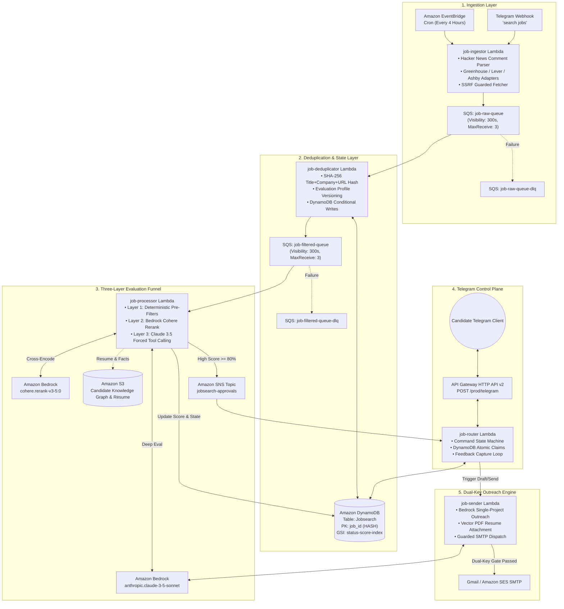
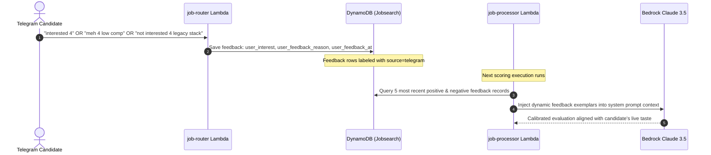

# Enterprise Architecture Specification: Autonomous Job Intelligence & Outreach Harness

> **Document Classification:** Engineering Whitepaper & Production System Design  
> **Target Audience:** Staff / Principal Engineers, AI Architects, and Open-Source Contributors  
> **Status:** Production / Implemented  

---

## 1. Executive Mission & System Principles

The **JobHunt** autonomous engine was designed to resolve a fundamental failure mode in modern recruitment automation: the unconstrained blast of low-quality, hallucinated outreach against stale postings.

The system enforces four primary engineering invariants:
1. **Mathematical Grounding Over Token Burn**: Drop 90%+ of irrelevant, stale, or low-signal leads in deterministic Python (0ms, $0) before invoking model inference.
2. **Serverless Cross-Encoder Reranking**: Batch-rerank candidate leads using Amazon Bedrock's native cross-encoders before performing deep LLM reasoning.
3. **Zero-Trust Identity Sovereignty**: Candidate identity, personal contact details, and credentials are strictly decoupled from tracked source code and injected at runtime via 12-factor configuration.
4. **Dual-Key Airgap Outreach**: The autonomous system *never* dispatches live outreach without dual-key human approval.

---

## 2. Distributed System Topology

The pipeline is implemented as an event-driven, decoupled microservices mesh on AWS serverless primitives:



---

## 3. The Three-Layer Quality Funnel

To achieve industry-leading matching precision without incurring the cost of heavy LLM inference over millions of tokens, JobHunt operates a **Three-Layer Funnel**:

```
[ Incoming Raw Postings from Web / ATS / Search ]
                       │
                       ▼
┌─────────────────────────────────────────────────────────────┐
│ Layer 1: Deterministic Pre-Filtering (0ms, $0)             │
│ • Freshness: HN <= 3 days, ATS <= 14 days                   │
│ • Domain & Title: Regex drop non-AI/ML roles                │
│ • Grounding: Mandatory canonical HTTPS URL & SSRF defense   │
│ • Guardrail Caps: Stale capped at 55, No URL capped at 40   │
└─────────────────────────────────────────────────────────────┘
                       │ (Drops ~70% of raw postings)
                       ▼
┌─────────────────────────────────────────────────────────────┐
│ Layer 2: Serverless Cross-Encoder Reranker                  │
│ • Bedrock native model: cohere.rerank-v3-5:0                │
│ • Cross-encodes canonical resume against candidate roles    │
│ • Single forward pass latency: ~150ms                       │
│ • Prunes batch to top 15% high-conviction opportunities     │
└─────────────────────────────────────────────────────────────┘
                       │ (Prunes to top 15%)
                       ▼
┌─────────────────────────────────────────────────────────────┐
│ Layer 3: Deep Context Grounding                             │
│ • Model: Anthropic Claude 3.5 Sonnet on AWS Bedrock        │
│ • Tool Choice: Forced submit_evaluation Tool-Call          │
│ • In-Context Feedback: Dynamic injection of 5 positive &   │
│   5 negative user decisions from Telegram DynamoDB history  │
│ • Structured Output: score, match_reasons, caveats, draft   │
└─────────────────────────────────────────────────────────────┘
                       │ (Only score >= 80% surfaces)
                       ▼
[ Telegram Review Queue: Guided 'next' -> 'why' -> 'apply' ]
```

### Layer 1: Deterministic Quality Pre-Filters
Executed entirely in local Python before any AWS network hop:
* **Freshness Check**: Postings with missing or stale timestamps are rejected. Hacker News postings have a strict 3-day cutoff (`HN_MAX_JOB_AGE_DAYS=3`). Direct ATS postings enforce a 14-day cutoff (`MAX_JOB_AGE_DAYS=14`).
* **Title & Domain Heuristics**: Compiled regex immediately excludes frontend-only, legacy backend (PHP/Java 8), IT support, and sales roles.
* **SSRF Protection**: Every outbound URL is validated against RFC 1918 private subnets and AWS metadata IPs (`169.254.169.254`).

### Layer 2: Serverless Cross-Encoder Reranking
Traditional pipelines either send full job descriptions to expensive LLMs or rely on coarse vector similarity (cosine distance over dense embeddings), which misses fine-grained negative constraints.
JobHunt uses **Amazon Bedrock Cohere Rerank v3.5**:
* Jointly scores the candidate's core profile and the job description in a single multi-sequence pass.
* Surfaces cross-attention signals between candidate achievements and job requirements.
* Operates 100% serverless with zero GPU provisioning or idle infrastructure costs.

### Layer 3: Deep Context Grounding (Claude 3.5 Sonnet)
Leads that pass Layers 1 and 2 are evaluated with forced tool-calling:
```json
{
  "toolChoice": {
    "tool": {
      "name": "submit_evaluation"
    }
  }
}
```
The model must output structured fields:
* `score` (integer 0–100)
* `match_reasons` (array of verified citations against candidate memory)
* `missing_requirements` (array of caveats or missing technologies)
* `personalized_email_draft` (concise outreach pitch citing exact source evidence)

---

## 4. In-Context Feedback Memory Engine

Unlike rigid static prompts or unstable self-modifying code, JobHunt learns continuously via **dynamic in-context few-shot injection**:



---

## 5. Data Contracts & Schemas

### DynamoDB Single-Table Schema (`Jobsearch`)

| Attribute | Type | Description |
| :--- | :--- | :--- |
| `job_id` (PK) | String (HASH) | Canonical SHA-256 hash: `hash(title + company + url)` |
| `created_at` | String (ISO-8601) | Ingestion timestamp |
| `status` | String | Lifecycle state: `PENDING_REVIEW`, `INTERESTED`, `APPLIED`, `REJECTED`, `SKIPPED` |
| `score` | Number | Normalized match score (0–100) |
| `source` | String | Origin adapter: `hacker_news`, `greenhouse`, `lever`, `ashby`, `google_cse` |
| `source_url` | String | Verified HTTPS canonical posting URL |
| `match_reasons` | List[String] | Claude evaluation citations |
| `missing_requirements` | List[String] | Caveats and technology gaps |
| `eval_version` | String | Evaluation model version (e.g., `v2026.1`) for safe requeueing |
| `user_interest` | String | Feedback signal: `interested`, `meh`, `not_interested` |
| `user_feedback_reason` | String | Optional qualitative feedback rationale |

### Global Secondary Indexes (GSIs):
1. **`status-score-index`**: Partition Key: `status`, Sort Key: `score` (Allows fast retrieval of top unreviewed matches).
2. **`source-created-index`**: Partition Key: `source`, Sort Key: `created_at` (Allows per-source freshness audits).

---

## 6. Guarded Outreach & Airgap Protocol

The system prevents autonomous spam via a **Dual-Key Airgap Architecture**:

```
                    ┌───────────────────────────┐
                    │  Telegram 'draft' Command  │
                    └─────────────┬─────────────┘
                                  │
                                  ▼
                    ┌───────────────────────────┐
                    │  job-sender Lambda Runs   │
                    │   (Generates Preview)     │
                    └─────────────┬─────────────┘
                                  │
                                  ▼
                    ┌───────────────────────────┐
                    │   Is Dual-Key Gate Met?   │
                    │ ALLOW_TELEGRAM_EMAIL_SEND │
                    │            AND            │
                    │   ALLOW_REAL_EMAIL_SEND   │
                    └──────┬─────────────┬──────┘
                           │             │
                    NO     │             │ YES
             ┌─────────────┘             └─────────────┐
             ▼                                         ▼
┌──────────────────────────┐             ┌──────────────────────────┐
│  Renders Preview in TG   │             │   Dispatches Live Email  │
│  Zero SMTP Invocations   │             │   with Attached PDF      │
│  Safe by Default         │             │   via Gmail / SES        │
└──────────────────────────┘             └──────────────────────────┘
```

Tone Constraints Enforced in Outreach Generation:
* Length strictly bounded to **under 130 words**.
* Zero generic buzzwords (*synergy, leverage, passionate, cutting-edge, thrilled*).
* Zero cover-letter pleasantries (*"I hope this email finds you well"*).
* Cites exactly **one** verified project matching the job post's technical challenge.

---

## 7. Fault Tolerance & Resilience Topology

1. **Dead-Letter Queues (DLQs)**:
   * Every SQS queue (`job-raw-queue`, `job-filtered-queue`) has an isolated DLQ configured with `maxReceiveCount=3`.
   * Unprocessable messages are quarantined without blocking queue throughput.
2. **Atomic DynamoDB Claims**:
   * Multi-user or concurrent Telegram actions use conditional expressions (`attribute_not_exists(claimed_by) OR claim_expires < :now`) to prevent duplicate applications.
3. **Automated Health Monitoring**:
   * Scheduled GitHub Action (`health-monitor.yml`) runs every 6 hours, querying CloudWatch metrics for Lambda errors, DLQ depths, and DynamoDB throttling events.

---

## 8. Multi-Agent Local Diagnostic Harness

Operational integrity is enforced through local diagnostic agents under `agents/`:

```
tools/ops/run_agents.py
├── --security  --> SecurityAuditorAgent (AST zero-loop check, credential regex scan)
├── --qa        --> QAAgent (Runs pytest suite, measures execution velocity)
├── --full      --> OrchestratorAgent + BackendEngineerAgent + AIEngineerAgent (Live AWS probe)
└── (default)   --> Comprehensive local offline health check
```

This ensures that any pull request or deployment is mathematically certified for security and performance before reaching AWS.
