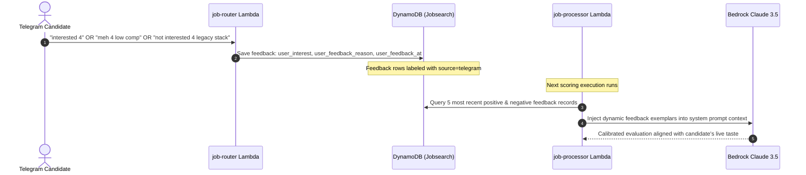

# Enterprise Architecture Specification: Autonomous Job Intelligence & Outreach Harness

> **Document Classification:** Engineering Whitepaper & Production System Design  
> **Target Audience:** Staff / Principal Engineers, AI Architects, and Open-Source Contributors  
> **Status:** Production / Implemented  

---

## 1. Executive Mission & System Principles

The **JobHunt** autonomous engine was designed to resolve a fundamental failure mode in modern recruitment automation: the unconstrained blast of low-quality, hallucinated outreach against stale postings.

The system enforces four primary engineering invariants:
The system enforces four primary engineering invariants:
1. **Mathematical Grounding Over Token Burn**: Drop 90%+ of irrelevant, stale, or low-signal leads in deterministic Python (no model inference calls) before invoking Bedrock.
2. **Serverless Cross-Encoder Reranking**: Batch-rerank candidate leads using Amazon Bedrock's native cross-encoders before performing deep LLM reasoning.
3. **Zero-Trust Identity Sovereignty**: Candidate identity, personal contact details, and credentials are strictly decoupled from tracked source code and injected at runtime via 12-factor configuration.
4. **Dual-Key Outreach & Approval Binding**: The autonomous system *never* dispatches live outreach without dual-key configuration flags AND cryptographic, time-bounded approval tied to the exact draft.

---

## 2. Distributed System Topology

### Production AI Job Intelligence Platform — Event-Driven AWS + Bedrock + HITL Architecture

The pipeline is implemented as an event-driven, decoupled microservices mesh on AWS serverless primitives:

```mermaid
flowchart TD
    subgraph INGESTION["1. Ingestion Layer"]
        CRON["Amazon EventBridge<br/>Cron (Every 4 Hours)"]
        TG_IN["Telegram Webhook<br/>'search jobs'"]
        ING["job-ingestor Lambda<br/>• Hacker News Comment Parser<br/>• Greenhouse / Lever / Ashby Adapters<br/>• SSRF Guarded Fetcher"]
        Q_RAW["SQS: job-raw-queue<br/>(Visibility: 300s, MaxReceive: 3)"]
        DLQ_RAW["SQS: job-raw-queue-dlq"]
    end

    subgraph DEDUP["2. Deduplication & State Layer"]
        DEDUP_FN["job-deduplicator Lambda<br/>• SHA-256 Title+Company+URL Hash<br/>• Evaluation Profile Versioning<br/>• DynamoDB Base Table Conditional Writes"]
        DDB[("Amazon DynamoDB<br/>Table: Jobsearch<br/>PK: job_id (HASH)<br/>GSI: status-score-index (Eventual)")]
        Q_FILT["SQS: job-filtered-queue<br/>(Visibility: 300s, MaxReceive: 3)"]
        DLQ_FILT["SQS: job-filtered-queue-dlq"]
    end

    subgraph EVAL["3. Three-Layer Evaluation Funnel"]
        PROC["job-processor Lambda<br/>• Layer 1: Deterministic Pre-Filters<br/>• Layer 2: Bedrock Cohere Rerank<br/>• Layer 3: Claude 3.5 Forced Tool Calling"]
        BEDROCK_RERANK["Amazon Bedrock<br/>cohere.rerank-v3-5:0 (Query + Docs)"]
        BEDROCK_CLAUDE["Amazon Bedrock<br/>anthropic.claude-3-5-sonnet"]
        S3_MEM[("Amazon S3<br/>Candidate Context & Resume")]
        SNS["Amazon SNS Topic<br/>jobsearch-approvals"]
    end

    subgraph CONTROL["4. Telegram Control Plane & Event Loop"]
        APIGW["API Gateway HTTP API v2<br/>POST /prod/telegram"]
        ROUTER["job-router Lambda<br/>• Command State Machine<br/>• Base Table Atomic Claims<br/>• Feedback Capture Loop"]
        TG_CLIENT(("Candidate Telegram Client"))
        TG_API["Telegram Bot API<br/>sendMessage / editMessageText"]
    end

    subgraph OUTREACH["5. Dual-Key Outreach Engine & Approval Binding"]
        SENDER["job-sender Lambda<br/>• Bedrock Single-Project Outreach<br/>• Vector PDF Resume Attachment<br/>• Guarded SMTP Dispatch"]
        APPROVAL_GATE{"Dual-Key Config & Approval Gate<br/>1. Config Flags Enabled<br/>2. SHA-256 Hash Bound to Exact Draft<br/>3. Atomic DynamoDB Approval Consumption"}
        SMTP["Gmail / Amazon SES SMTP<br/>Ambiguous Drops -> MANUAL_RECONCILIATION"]
    end

    CRON & TG_IN --> ING --> Q_RAW
    Q_RAW -. Failure .-> DLQ_RAW
    Q_RAW --> DEDUP_FN <--> DDB
    DEDUP_FN --> Q_FILT
    Q_FILT -. Failure .-> DLQ_FILT
    Q_FILT --> PROC
    PROC -.->|Load Candidate Context| S3_MEM
    PROC <-->|Text Query + Inline Job Docs| BEDROCK_RERANK
    PROC <-->|Structured Eval with XML Boundary Guard| BEDROCK_CLAUDE
    PROC -->|Update Score & State| DDB
    PROC -->|Fit Score >= 80/100| SNS --> ROUTER
    TG_CLIENT -->|Incoming Webhook (update_id deduplicated)| APIGW --> ROUTER
    ROUTER -->|Outgoing Async Bot API Calls| TG_API --> TG_CLIENT
    ROUTER <-->|Query Base Table & Atomic Claim| DDB
    ROUTER -->|Trigger Draft/Send with Approval Token| SENDER
    SENDER <--> BEDROCK_CLAUDE
    SENDER --> APPROVAL_GATE
    APPROVAL_GATE -->|Approved Send + Atomic Token Consume| SMTP
    APPROVAL_GATE -->|Preview Draft Default & Token Issue| TG_API
```

---

## 3. The Three-Layer Quality Funnel

To achieve industry-leading matching precision without incurring the cost of heavy LLM inference over millions of tokens, JobHunt operates a **Three-Layer Funnel**:

```
[ Incoming Raw Postings from Web / ATS / Search ]
                       │
                       ▼
┌─────────────────────────────────────────────────────────────┐
│ Layer 1: Deterministic Pre-Filtering                        │
│ (No model inference calls)                                  │
│ • Freshness: HN <= 3 days, ATS <= 14 days                   │
│ • Domain & Title: Regex drop non-AI/ML roles                │
│ • Grounding: Mandatory canonical HTTPS URL & SSRF defense   │
│ • Guardrail Caps: Stale capped at 55, No URL capped at 40   │
└─────────────────────────────────────────────────────────────┘
                       │ (Drops ~70% of raw postings)
                       ▼
┌─────────────────────────────────────────────────────────────┐
│ Layer 2: Serverless Cross-Encoder Reranker                  │
│ • Bedrock native model: cohere.rerank-v3-5:0                │
│ • Cross-encodes canonical context against candidate roles   │
│ • Operates via direct text query and inline documents       │
│ • Prunes batch to top high-conviction opportunities         │
└─────────────────────────────────────────────────────────────┘
                       │ (Sorts and filters leads)
                       ▼
┌─────────────────────────────────────────────────────────────┐
│ Layer 3: Deep Context Grounding                             │
│ • Model: Anthropic Claude 3.5 Sonnet on AWS Bedrock        │
│ • Tool Choice: Forced submit_evaluation Tool-Call          │
│ • In-Context Feedback: Dynamic injection of 5 positive &   │
│   5 negative user decisions from Telegram DynamoDB history  │
│ • Structured Output: score, match_reasons, caveats, draft   │
│ • Guard: XML tag sanitization against prompt injection      │
└─────────────────────────────────────────────────────────────┘
                       │ (Only fit score >= 80/100 surfaces)
                       ▼
[ Telegram Review Queue: Guided 'next' -> 'why' -> 'apply' ]
```

### Layer 1: Deterministic Quality Pre-Filters
Executed entirely in local Python before any AWS network hop:
* **Freshness Check**: Postings with missing or stale timestamps are rejected. Hacker News postings have a strict 3-day cutoff (`HN_MAX_JOB_AGE_DAYS=3`). Direct ATS postings enforce a 14-day cutoff (`MAX_JOB_AGE_DAYS=14`).
* **Title & Domain Heuristics**: Compiled regex immediately excludes frontend-only, legacy backend (PHP/Java 8), IT support, and sales roles.
* **SSRF Protection**: Every outbound URL is validated against RFC 1918 private subnets and AWS metadata IPs (`169.254.169.254`).

### Layer 2: Serverless Cross-Encoder Reranking
Traditional pipelines either send full job descriptions to expensive LLMs or rely on coarse vector similarity (cosine distance over dense embeddings), which misses fine-grained negative constraints.
JobHunt uses **Amazon Bedrock Cohere Rerank v3.5**:
* Jointly scores the candidate's core profile and the job description in a single multi-sequence pass.
* Surfaces cross-attention signals between candidate achievements and job requirements.
* Operates 100% serverless with zero GPU provisioning or idle infrastructure costs.

### Layer 3: Deep Context Grounding (Claude 3.5 Sonnet)
Leads that pass Layers 1 and 2 are evaluated with forced tool-calling:
```json
{
  "toolChoice": {
    "tool": {
      "name": "submit_evaluation"
    }
  }
}
```
The model must output structured fields:
* `score` (integer 0–100)
* `match_reasons` (array of verified citations against candidate memory)
* `missing_requirements` (array of caveats or missing technologies)
* `personalized_email_draft` (concise outreach pitch citing exact source evidence)

---

## 4. In-Context Feedback Memory Engine

Unlike rigid static prompts or unstable self-modifying code, JobHunt learns continuously via **dynamic in-context few-shot injection**:



---

## 5. Data Contracts & Schemas

### DynamoDB Single-Table Schema (`Jobsearch`)

| Attribute | Type | Description |
| :--- | :--- | :--- |
| `job_id` (PK) | String (HASH) | Canonical SHA-256 hash: `hash(title + company + url)` |
| `created_at` | String (ISO-8601) | Ingestion timestamp |
| `status` | String | Lifecycle state: `PENDING_REVIEW`, `INTERESTED`, `APPLIED`, `REJECTED`, `SKIPPED` |
| `score` | Number | Normalized match score (0–100) |
| `source` | String | Origin adapter: `hacker_news`, `greenhouse`, `lever`, `ashby`, `google_cse` |
| `source_url` | String | Verified HTTPS canonical posting URL |
| `match_reasons` | List[String] | Claude evaluation citations |
| `missing_requirements` | List[String] | Caveats and technology gaps |
| `eval_version` | String | Evaluation model version (e.g., `v2026.1`) for safe requeueing |
| `user_interest` | String | Feedback signal: `interested`, `meh`, `not_interested` |
| `user_feedback_reason` | String | Optional qualitative feedback rationale |

### Global Secondary Indexes (GSIs):
1. **`status-score-index`**: Partition Key: `status`, Sort Key: `score` (Allows fast retrieval of top unreviewed matches).
2. **`source-created-index`**: Partition Key: `source`, Sort Key: `created_at` (Allows per-source freshness audits).

---

## 6. Guarded Outreach & Airgap Protocol

The system prevents autonomous spam via a **Dual-Key Airgap Architecture**:

```
                    ┌───────────────────────────┐
                    │  Telegram 'draft' Command  │
                    └─────────────┬─────────────┘
                                  │
                                  ▼
                    ┌───────────────────────────┐
                    │  job-sender Lambda Runs   │
                    │   (Generates Preview)     │
                    └─────────────┬─────────────┘
                                  │
                                  ▼
                    ┌───────────────────────────┐
                    │   Is Dual-Key Gate Met?   │
                    │ ALLOW_TELEGRAM_EMAIL_SEND │
                    │            AND            │
                    │   ALLOW_REAL_EMAIL_SEND   │
                    └──────┬─────────────┬──────┘
                           │             │
                    NO     │             │ YES
             ┌─────────────┘             └─────────────┐
             ▼                                         ▼
┌──────────────────────────┐             ┌──────────────────────────┐
│  Renders Preview in TG   │             │   Dispatches Live Email  │
│  Zero SMTP Invocations   │             │   with Attached PDF      │
│  Safe by Default         │             │   via Gmail / SES        │
└──────────────────────────┘             └──────────────────────────┘
```

Tone Constraints Enforced in Outreach Generation:
* Length strictly bounded to **under 130 words**.
* Zero generic buzzwords (*synergy, leverage, passionate, cutting-edge, thrilled*).
* Zero cover-letter pleasantries (*"I hope this email finds you well"*).
* Cites exactly **one** verified project matching the job post's technical challenge.

---

## 7. Fault Tolerance & Resilience Topology

1. **Dead-Letter Queues (DLQs)**:
   * Every SQS queue (`job-raw-queue`, `job-filtered-queue`) has an isolated DLQ configured with `maxReceiveCount=3`.
   * Unprocessable messages are quarantined without blocking queue throughput.
2. **Atomic DynamoDB Claims**:
   * Multi-user or concurrent Telegram actions use conditional expressions (`attribute_not_exists(claimed_by) OR claim_expires < :now`) to prevent duplicate applications.
3. **Automated Health Monitoring**:
   * Scheduled GitHub Action (`health-monitor.yml`) runs every 6 hours, querying CloudWatch metrics for Lambda errors, DLQ depths, and DynamoDB throttling events.

---

## 8. Multi-Agent Local Diagnostic Harness

Operational integrity is enforced through local diagnostic agents under `agents/`:

```
tools/ops/run_agents.py
├── --security  --> SecurityAuditorAgent (AST zero-loop check, credential regex scan)
├── --qa        --> QAAgent (Runs pytest suite, measures execution velocity)
├── --full      --> OrchestratorAgent + BackendEngineerAgent + AIEngineerAgent (Live AWS probe)
└── (default)   --> Comprehensive local offline health check
```

This ensures that any pull request or deployment is mathematically certified for security and performance before reaching AWS.

---

## 9. Open-Source Readiness & Production Reliability Guarantees

### 9.1 Licensing & Job-Source Scraping Compliance
* **Project License**: JobHunt is licensed under the MIT License ([LICENSE](LICENSE)).
* **Dependency & Source Notices**: See [NOTICES.md](NOTICES.md) for full upstream dependency notices and scraping policy terms.
* **Scraping Compliance**: JobHunt interacts with public APIs (Hacker News Algolia Search API, direct ATS board JSON feeds from Greenhouse, Lever, and Ashby). Postings are fetched strictly for individual job evaluation. Contributors must never redistribute, resell, or bulk-republish scraped descriptions.

### 9.2 Deployment Scope: Single-User Sovereignty vs Multi-Tenant Isolation
* **Current Scope**: Each JobHunt deployment is architected as a sovereign, single-candidate pipeline. It isolates all candidate facts, resumes, evaluation weights, and feedback within a dedicated AWS account or private prefix.
* **Multi-Tenant Requirements**: If adapting JobHunt for a shared multi-tenant service, the following architectural controls must be enforced:
  1. **Partition Key Isolation**: Shard DynamoDB rows by tenant/candidate (`PK = tenant_id#job_id`).
  2. **Storage Separation**: Enforce per-user S3 prefixes (`data/users/{user_id}/resume.pdf`) with scoped IAM role session policies.
  3. **Queue & Webhook Routing**: Segregate Telegram chat IDs and enforce strict authorization allowlists per tenant.
  4. **Feedback & Model Weight Isolation**: Exemplars must be queried strictly per candidate ID.

### 9.3 DynamoDB Indexing: Eventual Consistency & Partition Hotspotting
* **Eventual Consistency on GSIs**: Queries against `status-score-index` are eventually consistent. Consequently, critical state transitions, approval checks, and claim locks are **strictly executed against the base table via conditional writes** (`UpdateItem` with `ConditionExpression`).
* **Partition Key Concentration**: In `status-score-index`, partition key is `status` (e.g. `PENDING_APPROVAL`). For personal workloads (<10,000 jobs), DynamoDB handles this effortlessly. For enterprise-scale volume (>100,000 active leads), the partition key should be sharded (e.g., `status#bucket_id`) to distribute write and read throughput across partitions.

### 9.4 CloudWatch Observability & Alarms
Production deployments should monitor the following alarms:
* **Queue Latency (`AgeOfOldestMessage > 300s`)**: Triggers an alert if SQS processing lags.
* **DLQ Visibility (`ApproximateNumberOfMessagesVisible > 0`)**: Alerts immediately if poison-pill messages enter `job-raw-queue-dlq` or `job-filtered-queue-dlq`.
* **Lambda Errors & Throttles**: Monitors execution errors across all 5 Lambdas.
* **Bedrock Client Throttling (`ThrottlingException`)**: Alerts when Bedrock API rate limits require exponential backoff.

### 9.5 Third-Party Dependency Availability & Google CSE Deprecation
* **Google Custom Search JSON API Deprecation**: Google has closed the Custom Search JSON API to new customers, with a published sunset/transition deadline of **January 1, 2027**. JobHunt defaults `GOOGLE_CSE_ENABLED="false"` and operates autonomously without Google CSE by relying on direct ATS adapters and Hacker News.
* **Model ID & Regional Availability**: Default model IDs (`anthropic.claude-3-5-sonnet-20241022-v2:0` and `cohere.rerank-v3-5:0`) are configurable via environment variables (`BEDROCK_MODEL_ID`, `BEDROCK_RERANK_MODEL_ID`, `AWS_REGION`). Verify availability in the target region (e.g., `us-east-1`, `us-west-2`) before deployment.

