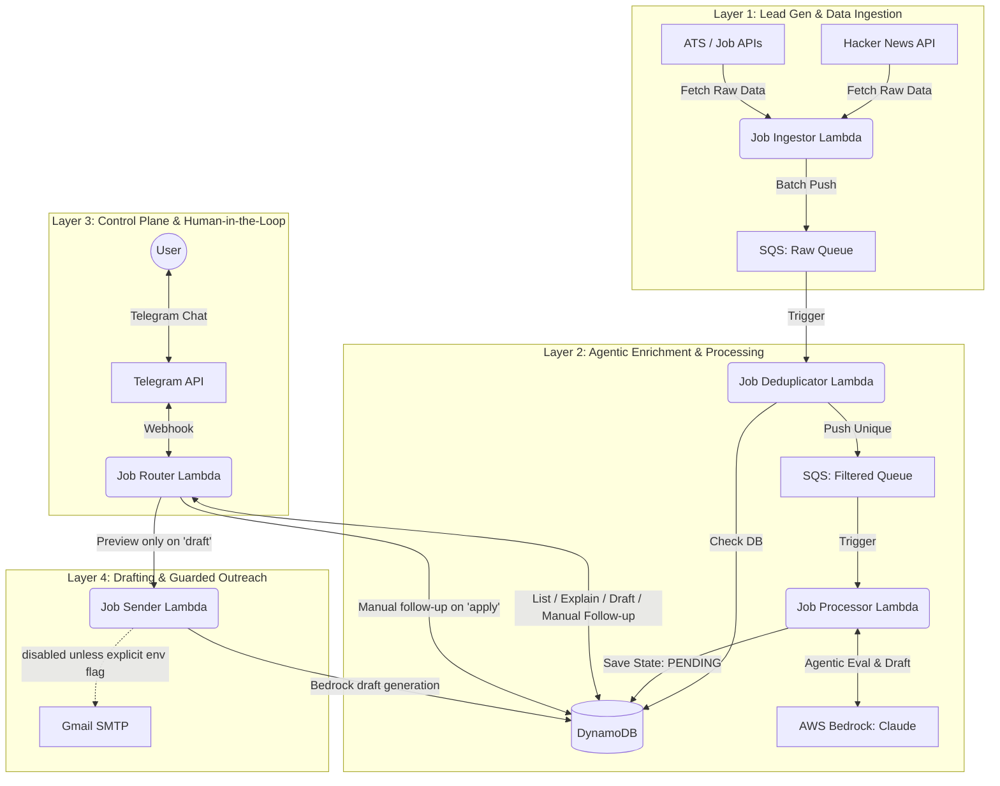

# Agentic Job Pipeline: System Architecture

*Prepared for: AI Outbound Agent Engineer Interview Discussion*

This document breaks down the multi-agent architecture of the JobHunt pipeline: source discovery, deduplication, model evaluation, human review, and guarded follow-up.

## Current Production Snapshot

* **Live AWS path:** Telegram -> API Gateway/Lambda router -> Lambda ingestion -> SQS -> deduplication -> SQS -> processor -> DynamoDB.
* **Active live sources:** Hacker News Who is Hiring and Direct ATS boards (Greenhouse, Lever, Ashby) are returning real jobs.
* **Configured but blocked sources:** Google CSE credentials exist, but Google returns HTTP 403 until Custom Search JSON API is enabled for that Google Cloud project. JSearch is configured but currently rate-limited with HTTP 429.
* **Safety controls:** Telegram `draft 1` previews outreach, `apply 1` moves a role to manual follow-up, and `send 1` is the only command that can send email. Real SMTP still requires `ALLOW_REAL_EMAIL_SEND=true` on the sender Lambda and `ALLOW_TELEGRAM_EMAIL_SEND=true` on the router Lambda.
* **Operational controls:** Both SQS queues have DLQs. CloudWatch alarms cover Lambda errors/throttles, queue backlog, and DLQ messages.
* **Current review policy:** only fresh, sourced, 80%+ matches enter the visible review queue.

## Why This Exists If Job Boards Already Exist

LinkedIn, Indeed, and Dice are good search surfaces, but they are not enough for this use case. The product value is not "another job board"; it is an agent workflow that:

* verifies source provenance before presenting a role,
* deduplicates the same role across multiple surfaces,
* scores against a specific candidate profile instead of generic keyword search,
* explains why a role was accepted or hidden,
* keeps human approval before outreach,
* records every state transition so the system can be audited.

For an outbound-sales analogy, LinkedIn is a lead database. This system is closer to a lead operations agent: ingest, normalize, score, cite evidence, draft, and require approval before action.

## Accuracy And Hallucination Controls

* Every visible opportunity must have a source URL.
* Missing source links are capped at 40 and rejected before the LLM.
* Missing dates, stale jobs, remote-only/non-local roles, and weak AI/ML signal are rejected or capped before the LLM.
* The scorer now has a labeled regression eval set: good match, weak match, stale job, remote/non-local job, and missing-source job.
* `status` and `list` expose source labels and links so the user can inspect evidence instead of trusting model text.
* Resume and project files are compacted into a candidate knowledge graph before scoring, reducing repeated Bedrock input tokens while keeping the strongest evidence.

## High-Level Architecture Diagram

---

## 1. The Lead Generation & Ingestion Layer
*Equivalent to pulling leads from public databases, ATS pages, and search APIs.*
* **Component:** `job-ingestor` (AWS Lambda)
* **Function:** Acts as the data scraper. It targets unstructured startup threads (Hacker News) and Applicant Tracking Systems (ATS) to pull high-intent leads.
* **Resilience:** It uses regex to extract recruiter emails and cleans messy HTML. It batches jobs in blocks of 10 and pushes them to AWS SQS (`job-raw-queue`) to prevent downstream throttling.

## 2. The Enrichment & Agentic Processing Layer
*Equivalent to using LLMs to research a prospect and decide if it is worth human attention.*
* **Components:** `job-deduplicator`, `job-processor` (AWS Lambdas), AWS Bedrock
* **Function:** 
  1. The deduplicator drops any jobs that already exist in DynamoDB, ensuring zero duplicate work.
  2. The processor acts as the core LLM Agent. It retrieves the job, feeds the description and the user's resume into Anthropic's Claude, and executes a deterministic evaluation.
  3. Claude returns a structured JSON payload containing: `score` (0-100), `reasoning`, and a highly `personalized_email_draft`.
* **State Management:** The processed lead is saved to DynamoDB with a state of `PENDING_APPROVAL`.

## 3. The Control Plane (Human-in-the-Loop) Layer
*Equivalent to a user dashboard where operators review and approve AI-generated campaign actions.*
* **Component:** `job-router` (AWS Lambda), Telegram Bot API
* **Function:** The user interface. Instead of building a complex React frontend, the system relies on a Telegram Webhook.
* **Interaction:** The user texts `status` to audit counts, roles, source names, source links, contacts, and model reasons. They use `list` for high-confidence matches, `explain 1` for scoring rationale, and `draft 1` for a preview-only outreach draft. `apply 1` only moves the item to manual follow-up and never sends email from Telegram.
* **Anti-hallucination rule:** Every visible opportunity must carry a source link. If a row has no source link, the bot tells the user not to act on it.

## 4. The Drafting & Guarded Outreach Layer
*Equivalent to generating a human-reviewed outbound step, with dispatch behind a safety gate.*
* **Component:** `job-sender` (AWS Lambda), Gmail API
* **Function:** When the user issues `draft 1`, the sender generates a preview-only draft. It does not fetch SMTP credentials or send email in preview mode.
* **Execution safety:** Real SMTP delivery is behind two switches: `ALLOW_TELEGRAM_EMAIL_SEND=true` on the router and `ALLOW_REAL_EMAIL_SEND=true` on the sender. This keeps the workflow useful without allowing `apply` or a background job to send email accidentally.
