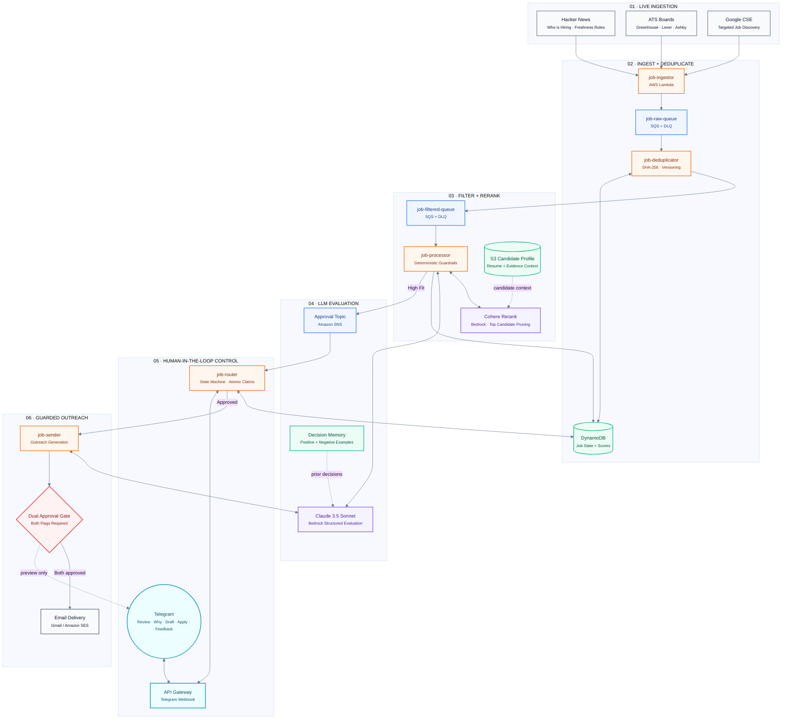
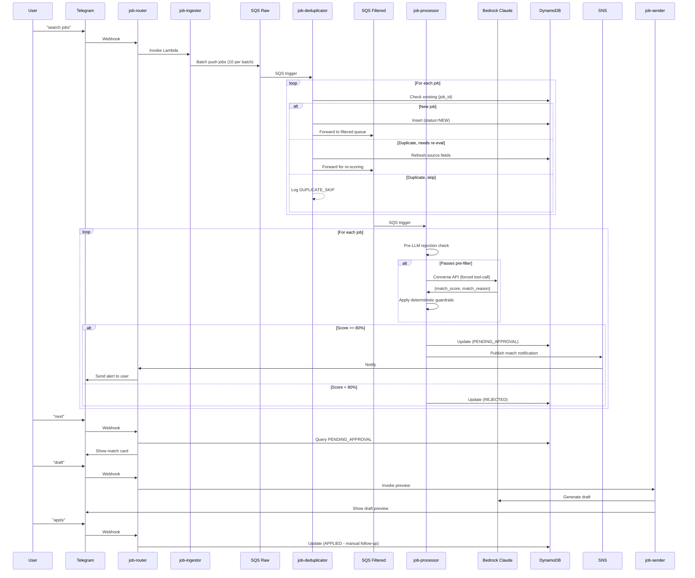
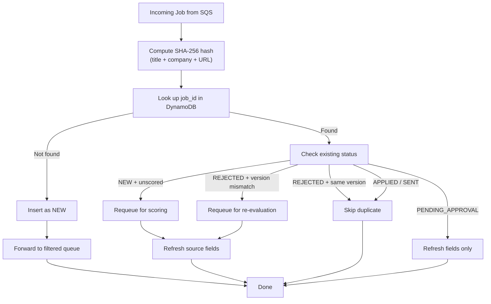
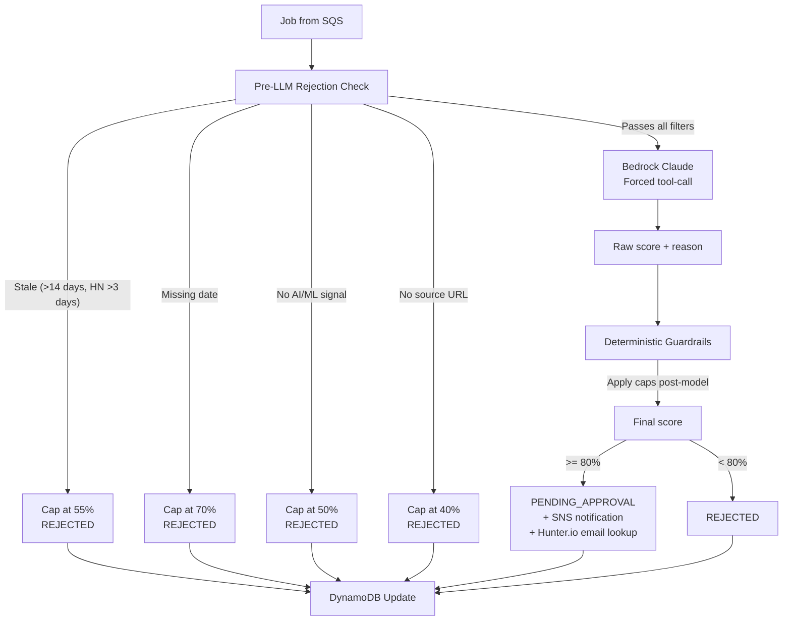
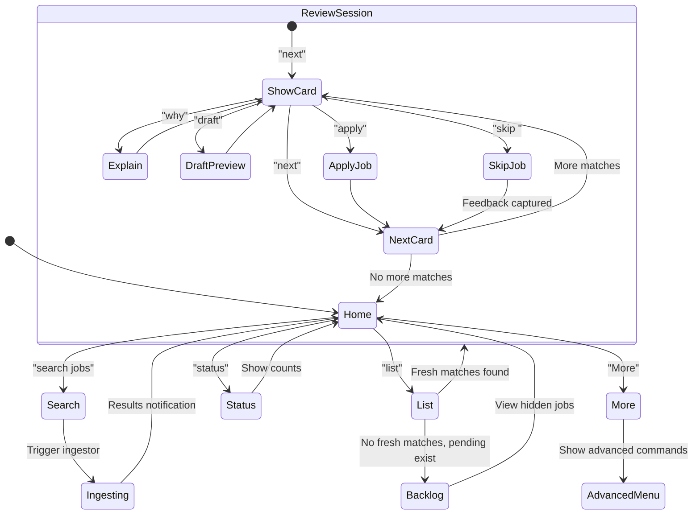
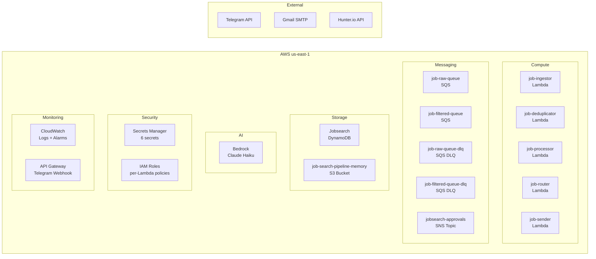
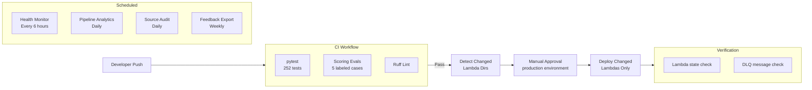

# Architecture Diagrams

## Production AI Job Intelligence Platform — Event-Driven AWS + Bedrock + HITL Architecture

## Message Flow

## Deduplication Logic

## Scoring Pipeline

## Telegram UX Flow

## Infrastructure

## CI/CD Pipeline

